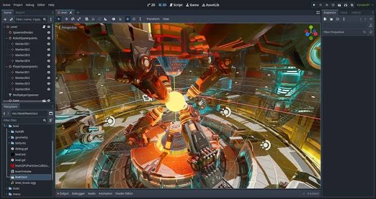
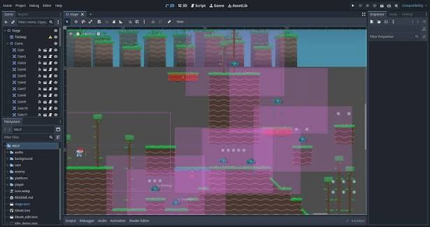

# Godot Engine Build Test And Export Scenes

A small playable scene makes input, collisions, feedback, and export requirements concrete.
Godot Engine combines a visual editor with reusable scenes and scripts for building 2D and 3D projects.

[](https://godot-latest-version.github.io/Godot-Engine/)

## Choose a target before committing to rendering features

Check the official [Godot Latest Version](https://godotengine.org/download/) alongside the documentation for the release you intend to use.
A development snapshot and a stable release can expose different features and compatibility requirements.

| Renderer | Typical target | Graphics backend family |
| --- | --- | --- |
| Forward+ | Desktop projects needing advanced rendering features | RenderingDevice |
| Mobile | Mobile and simpler desktop scenes | RenderingDevice |
| Compatibility | Web and hardware needing broader graphics support | OpenGL |

The [renderer overview](https://docs.godotengine.org/en/stable/tutorials/rendering/renderers.html) explains feature differences and driver requirements.
Try the intended renderer on representative target hardware early.

For readers examining the engine build, [glsl_builders.py](glsl_builders.py) and [gles3_builders.py](gles3_builders.py) generate shader-related source data.
[platform_methods.py](platform_methods.py) includes platform and CPU architecture aliases used by build tooling.
These implementation files are separate from the shaders and scripts belonging to a game project.

## Give one scene a complete movement loop

Create a player scene with a CharacterBody2D root, a CollisionShape2D child with an assigned shape, and a visible sprite.
For this top-down example, set the body's Motion Mode to Floating in the Inspector.

Attach this GDScript to the root and confirm the four named input actions have bindings:

```gdscript
extends CharacterBody2D
@export var speed: float = 240.0

func _physics_process(_delta: float) -> void:
    var direction := Input.get_vector("ui_left", "ui_right", "ui_up", "ui_down")
    velocity = direction * speed
    move_and_slide()
```

The velocity is measured in pixels per second; move_and_slide handles the physics-step duration.
Add a StaticBody2D with a collision shape to the test level so movement can be checked against an obstacle.



The [CharacterBody2D reference](https://docs.godotengine.org/en/stable/classes/class_characterbody2d.html) documents movement behavior, and the [Input reference](https://docs.godotengine.org/en/stable/classes/class_input.html) explains action-based controls.
Test diagonal movement, wall contact, and input focus before adding more systems.

## Let a pickup announce an event

A reusable pickup can detect the player and announce that it was collected.
Keep the level's score display outside the pickup scene so the same pickup can be used in another level.

Give the pickup an Area2D root, a CollisionShape2D child, and visible artwork.
Configure its collision mask to detect the player's collision layer, then attach:

```gdscript
extends Area2D
signal collected
func _ready() -> void:
    body_entered.connect(_on_body_entered)
func _on_body_entered(body: Node2D) -> void:
    if body is CharacterBody2D:
        collected.emit()
        queue_free()
```

Connect the collected signal to a score-updating method on the level or another appropriate controller.
This minimal example treats every CharacterBody2D as a collector; narrow that condition when other characters are introduced.
The [Area2D reference](https://docs.godotengine.org/en/stable/classes/class_area2d.html) describes body detection and collision-shape requirements.



Signals make the event available without hardcoding a path from the pickup to a particular HUD.
Keep ownership and lifetime clear when instancing or removing scenes.

## Measure the scene under a repeatable workload

Use the editor's debugger, profiler, and monitors to investigate a specific symptom.
Reproduce the same scene, object count, camera view, and input sequence when comparing changes.

- Check frame time when adding effects or increasing object counts.
- Separate rendering cost from script and physics work.
- Watch node and memory growth during repeated scene changes.
- Compare an exported build on the target device as well as the editor run.

The monitor implementation is supplied in [performance.cpp](main/performance.cpp), with its interface in [performance.h](main/performance.h).
[performance.compat.inc](main/performance.compat.inc) preserves a compatibility binding for a custom-monitor method.

Frame timing and physics-step coordination are represented by [main_timer_sync.cpp](main/main_timer_sync.cpp) and [main_timer_sync.h](main/main_timer_sync.h).
They help explain the engine's timing machinery; changing them is not required to tune a normal gameplay script.

## Export a project with its preset and matching templates

Create and test an export preset before automating the export.
Install export templates matching the editor version, and create the destination directory in advance.

With a Godot editor executable available as godot, this Bash command exports an existing project using a preset named Windows Desktop:

```bash
godot --headless --path "./prototype" \
  --export-release "Windows Desktop" "builds/prototype.exe"
```

The prototype directory must contain the project and its export preset; the builds directory is relative to that project.
The quoted preset name must match the saved preset exactly.
Use an editor executable for export, rather than a game export-template binary.

The [command-line guide](https://docs.godotengine.org/en/stable/tutorials/editor/command_line_tutorial.html) documents project paths, headless mode, and export switches.
The supplied [main.cpp](main/main.cpp) handles application startup and command-line options; [main.h](main/main.h) declares the main application interface.

Run the exported game separately to check input, asset loading, window behavior, and scene transitions.
A successful export does not establish that every target-device behavior matches the editor.

## Identify the engine snapshot behind the project

For godot 4 projects, keep the editor version, export-template version, renderer, and extension requirements with the project notes.
The uploaded [version.py](version.py) identifies a 4.8 beta source snapshot; that label does not identify the current stable release.

The godot open source build material supplied here includes:

- Main-module build rules: [SCsub](main/SCsub).
- Embedded splash and icon generation: [main_builders.py](main/main_builders.py).
- Shared build helpers: [methods.py](methods.py).
- Single-compilation-unit source generation: [scu_builders.py](scu_builders.py).

The image inputs [splash.png](main/splash.png) and [app_icon.png](main/app_icon.png) belong to the engine build.
Use your own project artwork and export settings when preparing the identity of a game.

Keep a project under version control before changing engine versions.
Check the matching release notes and migration guidance, especially for native extensions and platform-specific integrations.

## Retain the relevant project notices

The phrase godot open source game engine refers to the engine's publicly available code and development model.
The supplied [COPYRIGHT.txt](COPYRIGHT.txt) records copyright and licensing information, including material with terms differing from the engine's main license.
[AUTHORS.md](AUTHORS.md) acknowledges engine contributors, and [DONORS.md](DONORS.md) acknowledges financial support.

## Related Search Terms

Godot Latest Version, Godot Engine, godot 4, godot open source, godot open source game engine, godot, godotengine, game-engine, game-development, gamedev, gdscript, 2d, 3d, multi-platform, open-source
